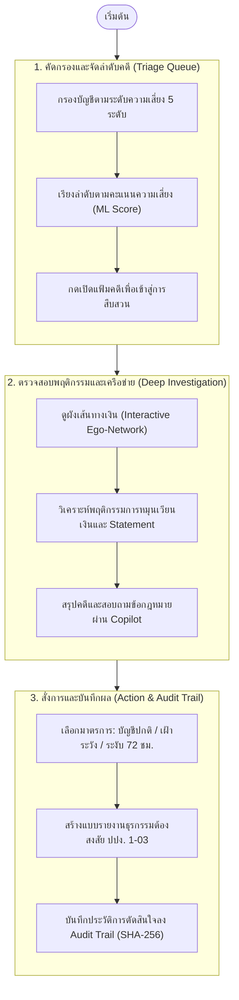

# Sherlock: ต้นแบบระบบตรวจจับและวิเคราะห์ความเสี่ยงบัญชีม้า
**Mule Account Detection & Decision Support Workbench (Prototype)**

> **คำชี้แจง:** โครงการนี้เป็น **ระบบต้นแบบ (Prototype / Proof of Concept)** จัดทำขึ้นเพื่อการศึกษาวิจัยและทดสอบแนวคิดการตรวจจับบัญชีม้าเชิงรุก โดยจำลองการทำงานตามแนวทางของธนาคารแห่งประเทศไทย (ธปท.) และ พ.ร.ก. มาตรการป้องกันและปราบปรามอาชญากรรมทางเทคโนโลยี พ.ศ. 2566 มิได้เป็นระบบงานจริงของสถาบันการเงิน

---

## 1. ที่มาและวัตถุประสงค์ของโครงการ (Background & Objective)

ปัญหาบัญชีม้าเป็นช่องทางหลักที่กลุ่มมิจฉาชีพใช้ในการเคลื่อนย้ายเงินที่ได้จากการหลอกลวง การตรวจสอบแบบเดิมที่รอรับแจ้งความจากผู้เสียหายมักทำให้การระงับเงินไม่ทันการณ์ ธนาคารแห่งประเทศไทย (ธปท.) จึงสนับสนุนให้สถาบันการเงินพัฒนาแนวทางตรวจจับเชิงรุก (Proactive Detection) เพื่อตรวจพฤติกรรมต้องสงสัยล่วงหน้า

โครงการ Sherlock จึงถูกพัฒนาขึ้นเป็น **แดชบอร์ดต้นแบบสำหรับเจ้าหน้าที่ตรวจสอบ (Fraud Analyst)** โดยมีองค์ประกอบการทำงาน 3 ด้าน:
1. **การวิเคราะห์ข้อมูลด้วยโมเดล Machine Learning:** คำนวณคะแนนความเสี่ยง (Risk Score 0–100) จากพฤติกรรมการทำธุรกรรมและเครือข่ายเส้นเงิน
2. **การสนับสนุนการตัดสินใจ (Human-in-the-Loop):** นำเสนอข้อมูล สรุปพฤติกรรม และให้เจ้าหน้าที่เป็นผู้ตัดสินใจสั่งการตามขั้นตอนกฎหมาย
3. **การคุ้มครองผู้เสียหาย (Victim Protection):** วิเคราะห์บัญชีคู่สัญญาเพื่อแยกแยะระหว่างบัญชีม้ากับประชาชนที่ถูกหลอกโอนเงิน

---

## 2. แหล่งที่มาของข้อมูล (Dataset Source)

โครงการนี้ใช้ชุดข้อมูลจำลองธุรกรรมทางการเงินสำหรับการวิจัยจาก **[TransXion Benchmark Dataset](https://github.com/chaos-max/TransXion)**:
* **คลังข้อมูลต้นทาง:** [https://github.com/chaos-max/TransXion](https://github.com/chaos-max/TransXion)
* **ข้อมูลประกอบด้วย 3 ตารางหลัก:**
  1. **`tx.csv` (ประวัติการทำธุรกรรม):** รายการโอนเงินจำนวน 2,714,741 รายการ ระบุบัญชีต้นทาง, บัญชีปลายทาง, วันเวลา, จำนวนเงิน และป้ายกำกับธุรกรรมฟอกเงิน (`Is Laundering`)
  2. **`person.csv` (ข้อมูลบุคคล):** ข้อมูลประชากรศาสตร์ของเจ้าของบัญชี 46,400 ราย ระบุอายุและอาชีพ
  3. **`merchant.csv` (ข้อมูลร้านค้า/นิติบุคคล):** ข้อมูลนิติบุคคล 1,330 แห่ง ระบุทุนจดทะเบียนและประเภทธุรกิจ
* **การนำมาใช้งาน:** นำข้อมูลมาสกัดตัวแปรพฤติกรรม (Feature Engineering) เช่น การโอนเงินเข้าออกเร็ว (Pass-through), ช่วงเวลาโอนเงิน, ความเชื่อมโยงในกราฟ และจำลองการจัดกลุ่มความเสี่ยงตามเกณฑ์ ธปท.

---

## 3. การจัดระดับความเสี่ยง 5 ระดับ และมาตรการตอบสนอง

ระบบแปลงคะแนนความเสี่ยงของโมเดลร่วมกับข้อมูลหลักฐานเชิงคดี เข้าสู่เกณฑ์ 5 ระดับตามแนวทาง ธปท.:

| ระดับความเสี่ยง | ช่วงคะแนน | ที่มาในระบบจริง | มาตรการตอบสนอง |
| :--- | :---: | :--- | :--- |
| **ม้าดำ** | มากกว่า 80 | รายชื่อบัญชีดำ ปปง. | อายัดถาวร และปิดบัญชีทุกธนาคาร |
| **ม้าเทาเข้ม** | 70 - 100 | มีใบแจ้งความ | ระงับทันที และแกะรอยเส้นเงินต่อ |
| **ม้าเทาอ่อน** | 50 - 69.9 | เส้นเงินเชื่อมต่อจากม้าเทาเข้ม | ระงับธุรกรรมช่องทางอิเล็กทรอนิกส์ |
| **ม้าน้ำตาลเข้ม** | 35 - 49.9 | ตรวจจับล่วงหน้าด้วยระบบ | ระงับชั่วคราว 72 ชม. ให้เจ้าหน้าที่ตรวจสอบ |
| **ม้าน้ำตาลอ่อน** | 20 - 34.9 | ตรวจจับล่วงหน้าด้วยระบบ | เพิ่มความเข้มงวด บังคับสแกนใบหน้า ลดเพดานวงเงินโอน |
| **บัญชีปกติ** | น้อยกว่า 20 | พฤติกรรมทั่วไป | ใช้งานได้ตามปกติ |

> **หมายเหตุ :** ในโมเดลทดสอบยังไม่มีฐานข้อมูลคดีจริง ระบบแปลงข้อมูล คะแนน 1-100 เข้าสู่ 5 ระดับนี้อัตโนมัติ โดยในกรณีของ **ม้าเทาเข้ม (ช่วงคะแนน 70 - 100)** เกิดจากบัญชีที่โมเดลตรวจพบความเสี่ยงสูงมาก แต่ยังไม่มีชื่อยืนยันในบัญชีดำ ปปง. ระบบจึงจัดให้อยู่ในกลุ่มม้าเทาเข้มเพื่อให้เจ้าหน้าที่ระงับธุรกรรมทันทีและสืบสวนต่อ

---

## 4. ขั้นตอนการทำงานของแดชบอร์ด (Dashboard Workflow)

ขั้นตอนการตรวจสอบของเจ้าหน้าที่บนแดชบอร์ดแบ่งเป็น 3 ขั้นตอน:



### หน้าจอการทำงานทั้ง 5 แท็บ:
* **แท็บ 1: ภาพรวมสถิติ (Executive Overview)** — สรุปจำนวนบัญชีตามระดับความเสี่ยง, มูลค่าธุรกรรมที่ตรวจพบ และสัดส่วนการโอนเงินช่วงวิกาล
* **แท็บ 2: คิวงานคัดกรอง (Case Triage Queue)** — ตารางจัดลำดับบัญชีต้องสงสัย กรองตามคะแนน สถานะงาน และจัดเรียงข้อมูล
* **แท็บ 3: ห้องสืบสวนคดี (Deep Investigation)** — แผนภาพเครือข่ายเส้นเงิน (Ego-Network), สรุปพฤติกรรมบัญชี และระบบช่วยตอบคำถาม AI Copilot
* **แท็บ 4: แบบรายงาน ปปง. 1-03 (AMLO STR Form)** — สร้างเอกสารรายงานธุรกรรมที่มีเหตุอันควรสงสัย พร้อมพิมพ์เป็นไฟล์ PDF
* **แท็บ 5: บันทึกประวัติการตรวจสอบ (Audit Trail)** — ประวัติการสั่งการของเจ้าหน้าที่ พร้อมรหัสแฮช SHA-256 ตรวจสอบย้อนหลังได้

---

## 5. โครงสร้างโมเดลและผลการประเมิน (Model & Benchmark)

ระบบทดสอบด้วยโมเดล 2 รูปแบบทำงานร่วมกัน:
1. **XGBoost (น้ำหนัก 40%):** เรียนรู้จากลักษณะพฤติกรรมเดี่ยว เช่น ความเร็วในการโอนเงินออก, ยอดเงินคงเหลือ, และสัดส่วนการโอนเงินช่วงกลางคืน
2. **GraphSAGE (น้ำหนัก 60%):** โครงข่ายประสาทเทียมแบบกราฟ (Graph Neural Network) ความลึก 2 ชั้น เรียนรู้จากความเชื่อมโยงในเครือข่ายเส้นเงินเพื่อตรวจจับการส่งต่อเงินหลายทอด

### ผลการทดสอบบนชุดข้อมูลทดสอบ (Unseen Test Set: 4,417 บัญชี)

| ตัววัดประสิทธิภาพ (Metric) | โมเดล XGBoost | โมเดล GraphSAGE | โมเดลผสม (Ensemble) | ความหมายในทางปฏิบัติ |
| :--- | :---: | :---: | :---: | :--- |
| **Precision@100** | 100.0% | 99.0% | **100.0%** | 100 บัญชีแรกที่ระบบจัดลำดับให้ตรวจ เป็นบัญชีม้าจริงทั้งหมด |
| **Precision** | 93.92% | 86.83% | **93.63%** | ความแม่นยำในการระบุ ช่วยลดการรบกวนบัญชีผู้บริสุทธิ์ |
| **Recall** | 82.50% | 86.19% | **89.32%** | ความสามารถในการตรวจจับม้าได้เกือบ 90% ของม้าทั้งหมด |
| **F1-Score** | 87.84% | 86.51% | **91.42%** | ค่าเฉลี่ยความสมดุลระหว่าง Precision และ Recall |
| **PR-AUC** | 89.83% | 91.69% | **93.60%** | ดัชนีวัดประสิทธิภาพภาพรวมสำหรับข้อมูลทุจริต |
| **ROC-AUC** | 95.46% | 96.20% | **97.31%** | ความสามารถในการแยกแยะกลุ่มบัญชีปกติกับบัญชีม้า |

---

## 6. โครงสร้างไฟล์ในโปรเจกต์ (Project Structure)

```text
sherlock/
├── .gitignore                   # รายการไฟล์ที่ไม่นำเข้า Git
├── README.md                    # เอกสารอธิบายระบบฉบับนี้
├── requirements.txt             # รายการไลบรารีที่จำเป็น
├── run_dashboard.sh             # สคริปต์เปิดรันแดชบอร์ด
│
├── configs/                     # การตั้งค่าระบบ
│   └── split.yaml               # กำหนดวันตัดแบ่งข้อมูล (train_end: 2025-11-25)
│
├── data/                        # การจัดเก็บข้อมูล
│   ├── raw/                     # ไฟล์ข้อมูลดิบ (tx.csv, person.csv, merchant.csv)
│   └── processed/               # ไฟล์ข้อมูลที่ผ่านการประมวลผลแล้ว
│       ├── predictions.parquet  # ผลคะแนนความเสี่ยงและการจัดกลุ่ม 5 ระดับ
│       ├── model_benchmark.json # ตัวเลขผลการประเมินโมเดล
│       └── audit_trail_v2.db    # ฐานข้อมูล SQLite บันทึก Audit Trail
│
├── eda/                         # โค้ดและรายงานการวิเคราะห์ข้อมูลเบื้องต้น
│   ├── 01_overview_and_behavioral_eda.py
│   ├── 02_graph_and_entity_eda.py
│   ├── deep_temporal_eda.py
│   └── *.md                     # รายงานสรุปผลเชิงลึก
│
├── models/                      # น้ำหนักโมเดล
│   └── graphsage.pt             # ไฟล์น้ำหนัก GraphSAGE (PyG)
│
├── scripts/                     # สคริปต์คำนวณและประเมินผล
│   ├── eval_test_set.py
│   └── eval_hybrid.py
│
└── src/                         # ซอร์สโค้ดหลัก
    ├── data/                    # การคลีนและตัดแบ่งข้อมูล
    ├── features/                # การสร้างตัวแปรพฤติกรรม
    ├── models/                  # การเทรนและประเมินผลโมเดล
    └── dashboard/               # โค้ดแดชบอร์ด Streamlit, กราฟ และ AI Copilot
```

---

## 7. วิธีการติดตั้งและรันระบบ (Quick Start)

### 1. ติดตั้งไลบรารี
```bash
git clone https://github.com/SUPAGORN0306/sherlock.git
cd sherlock
pip install -r requirements.txt
```

### 2. รันแดชบอร์ด
```bash
streamlit run src/dashboard/app.py
```
เปิดใช้งานผ่านบราวเซอร์ที่ `http://localhost:8501`

---

## 8. ข้อกำหนดด้านความถูกต้องและธรรมาภิบาล (Governance & Controls)
- **การแยกช่วงเวลาข้อมูลอย่างเข้มงวด (Temporal Split):** สร้างตัวแปรและกราฟจากข้อมูลก่อนวันที่ `2025-11-25` เท่านั้น เพื่อไม่ให้โมเดลเห็นข้อมูลอนาคต
- **ระบบบันทึกประวัติการสั่งการ (Audit Trail):** บันทึกทุกคำสั่งการระงับบัญชีพร้อมรหัส SHA-256 เชื่อมโยงย้อนหลัง ตรวจสอบได้
- **การแจ้งเตือนเพื่อคุ้มครองเหยื่อ (Victim Alert):** ตรวจจับเส้นเงินที่โอนไปยังม้า เพื่อแจ้งเตือนเจ้าหน้าที่ไม่ให้เผลออายัดบัญชีผู้เสียหาย
- **รองรับ 2 ภาษา:** สลับการแสดงผลภาษาไทยและอังกฤษได้บนหน้าแดชบอร์ด
